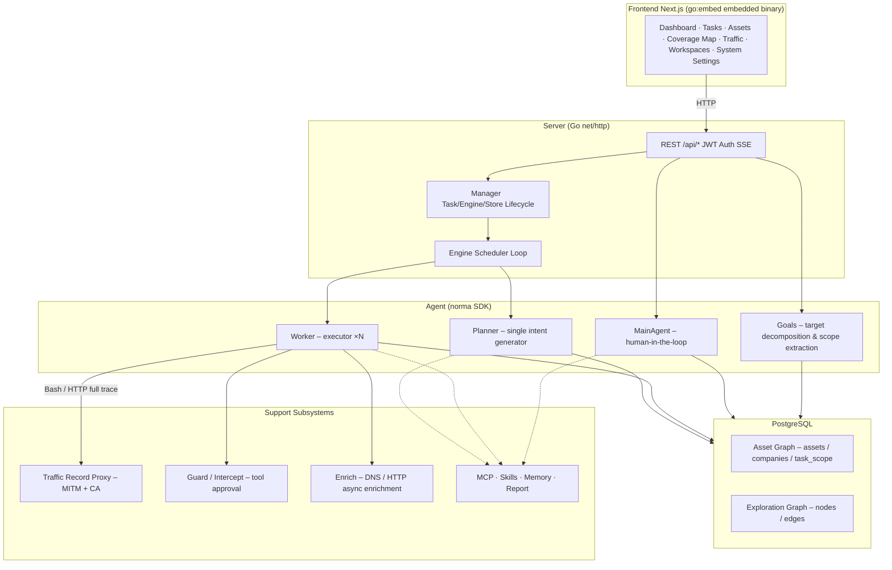

# LEVIATHAN

AI autonomous penetration testing system (Go backend + Next.js frontend)

---

## Approval Record Details

Global "Approval Records" and task‑level "Intercept Approvals" as well as approval cards in conversations can be expanded to view details. The structure follows the component used in [AegisHook's approval detail component](https://github.com/RuoJi6/AegisHook/blob/main/web/src/components/CallDetail.vue), using LEVIATHAN's component and theme.

---

## Asset Synchronization (ScopeSentry)

Supports direct synchronization of asset data from [ScopeSentry](https://github.com/Autumn-27/ScopeSentry), eliminating duplicate collection:
- On the **Asset Sync** page, enter the ScopeSentry address and API Key to connect the data source.
- Choose synchronization targets and asset types (domains / subdomains / IPs / ports / sites / endpoints…) by **Project** or **Task**.
- Import with one click and merge according to company asset scope, making the assets directly usable in LEVIATHAN's asset graph for agents.

---

## Installation

> Requires **PostgreSQL** database; configure **LLM** (set `ANTHROPIC_API_KEY` or `OPENAI_API_KEY`, also configurable via UI).

### Method 1: One‑Click Install Script (recommended)

```bash
git clone <your-repository-url> leviathan
cd leviathan
./install.sh
```
The script will:
- Detect / automatically install Docker → let you choose **① Full Docker** or **② Local Build**:
  - **① Full Docker**: Provide a Postgres password (Enter to generate random) → automatically write `.env` → `docker compose up -d`.
  - **② Local Build**: Choose a database (existing or Docker‑started) → generate `config.json` → compile the Go binary → start.
After installation, open **http://localhost:8787** (first visit go to `/setup` to set admin password).

### Method 2: Docker Compose (manual)

```bash
git clone <your-repository-url> leviathan
cd leviathan
cp .env.example .env          # fill POSTGRES_PASSWORD, optional ANTHROPIC_API_KEY
docker compose up -d          # builds the leviathan image from source (first run takes a few minutes), starts it + postgres
# → http://localhost:8787
```
The image includes common tools (ripgrep, curl, vim, npm, nmap…). `./skills` and `./data` are mounted for persistence.

### Remote MCP Configuration

You can select `http` (Streamable HTTP) or `sse` (legacy SSE) in system settings. SSE services typically use `GET /sse` to establish an event stream, then receive JSON‑RPC requests via `/message?sessionId=...`. Configure the URL as `/sse` and set the `Authorization=Bearer <token>` header.

### Method 3: Download a Pre‑compiled Binary (if you publish Releases)

If you set up `.github/workflows/release.yml` to build and publish releases for your own repository, download the appropriate zip from your repo's Releases page — it contains `leviathan` + `start.sh` (Windows: `start.bat`) + `skills/` + `config.example.json`:
```bash
cp config.example.json config.json   # fill database connection
./start.sh                           # → http://localhost:8787
```
> Use `start.sh` / `start.bat` to launch; do not run `./leviathan` directly. It is a daemon script: when the program exits, the exit code decides whether to restart it.
> Background daemon example: `nohup ./start.sh >leviathan.log 2>&1 &`.

### Method 4: Build from Source (single binary)

```bash
# Frontend static export
cd web && npm ci && npm run build:static && cd ..
# Copy into embedded directory
cp -r web/out server/webui/dist
# Compile (use -tags embedui to embed frontend)
CGO_ENABLED=0 go build -tags embedui -o leviathan ./cmd/leviathan
./start.sh
```

### Method 5: Cross‑Platform Release Package

`build.sh` builds and embeds the frontend, then strips debugging info and compresses the release zip. Release mode generates Linux amd64/arm64, macOS amd64/arm64, and Windows amd64 zip packages:
```bash
./build.sh --release
# Output: dist/leviathan-0.3.3-*.zip
```
UPX self‑extracting binaries may be incompatible with some Linux kernels, virtualization environments, or security policies, so it is disabled by default. You can enable it with `LEVIATHAN_TARGETS` and `--upx` when you have confirmed compatibility.

---

## Update & Upgrade

> Upgrading replaces the program without touching data: PostgreSQL volume `pgdata`, `./data` (jwt.key / SQLite etc.), and `./skills` are preserved. **Database migrations are automatic** – each start runs `schema.sql` idempotently (adds columns, creates indexes if not existing).
>
> There's no in-app update button — updates are a rebuild, triggered from the shell. This keeps a running server from ever silently fetching and swapping its own binary from the network.

### Method 1: Update Script (recommended)

```bash
cd leviathan
./update.sh
```
The script optionally runs `git pull` then lets you choose **① Docker Update** or **② Local Build Update** (mirroring `install.sh`):
- **① Docker**: Rebuilds the `leviathan` image from source (`docker compose build`) → `docker compose up -d` (restart runs the schema migration automatically).
- **② Local**: Rebuild frontend static assets → re‑compile `./leviathan` (changes take effect after restart).

### Method 2: Manual Docker Compose Update

```bash
cd leviathan
git pull                              # update source / compose / scripts
docker compose build --no-cache leviathan
docker compose up -d leviathan        # restart → automatic schema migration
docker image prune -f                 # optional cleanup of old images
```

### Method 3: Pre‑compiled Binary (if you publish Releases)

Download the new zip from your repo's Releases page, stop the old process, replace `leviathan` and `skills/` (keep your `config.json` and `data/`), then restart:
```bash
cp -r <extracted>/skills ./ && cp <extracted>/leviathan ./
./start.sh
```

### Method 4: Build from Source

```bash
git pull
cd web && npm ci && npm run build:static && cd ..
cp -r web/out server/webui/dist
CGO_ENABLED=0 go build -tags embedui -o leviathan ./cmd/leviathan
# Restart
./start.sh
```

---

## Configuration

**Database** (`config.json` or via `LEVIATHAN_PG_DSN` env):
```json
{
  "database": {
    "host": "127.0.0.1",
    "port": 5432,
    "user": "leviathan",
    "password": "yourpass",
    "dbname": "leviathan",
    "sslmode": "disable"
  }
}
```
**LLM**: `export ANTHROPIC_API_KEY=sk-...` (or `OPENAI_API_KEY`), also configurable in the UI's **LLM Configuration** page.
Built-in providers: `anthropic`, `openai`, `openai-responses`, `deepseek`, `glm` (Zhipu), `kiwi` (LLM.kiwi). Pick one in the UI or via `LEVIATHAN_LLM_PROVIDER`; the OpenAI-compatible ones (DeepSeek/GLM/Kiwi) use `OPENAI_API_KEY` or the generic `LEVIATHAN_LLM_API_KEY`.
Optional: `LEVIATHAN_LLM_MODEL`, `LEVIATHAN_LLM_BASE_URL`, `LEVIATHAN_LLM_PROXY`, `LEVIATHAN_LLM_API_KEY`.
**Concurrency**: Number of workers per task is configurable in **System Settings** (default 3).
**Common Parameters**: `./start.sh -addr :8787 -proxy :8788` (pass directly to `leviathan`).

### Reverse Proxy Deployment (HTTPS / expose only 443)

Both frontend and API/SSE share the same backend port (default `:8787`). Real‑time activity stream uses the same origin, so **no need to set `NEXT_PUBLIC_SSE_BASE`**. Expose only 443 externally and keep 8787 internal.
SSE requires disabling buffering; otherwise browsers may connect but receive no events. Nginx example:
```nginx
server {
    listen 443 ssl;
    server_name your.domain.com;
    # ssl_certificate / ssl_certificate_key ...

    location / {
        proxy_pass http://127.0.0.1:8787;
        proxy_set_header Host $host;
        proxy_set_header X-Forwarded-Proto $scheme;
        # SSE critical settings:
        proxy_buffering off;
        proxy_cache off;
        proxy_read_timeout 3600s;
        proxy_http_version 1.1;
        proxy_set_header Connection "";
    }
}
```
Only set `NEXT_PUBLIC_SSE_BASE` during build if SSE must use a different origin.

---

## Development

### Manual Vulnerability Re‑testing

The "Re‑test" tab on a task’s vulnerability detail page allows pagination to select vulnerabilities, view historical conclusions/evidence, and manually launch a re‑test. After starting, the tab shows a loading spinner and "Re‑testing" status. Once a fix is confirmed, the vulnerability status updates automatically.
- Click "Re‑test" on a vulnerability row or in the detail section to open a dedicated re‑test Agent session.
- New builds include a pre‑configured "retester" Agent (`retester`) which can be customized in Agent Management (prompt, LLM, budget, tools).
- When a re‑test session finishes with "Fixed", the vulnerability state changes to "Fixed" automatically.

### Local Run & Test

```bash
./dev.sh    # backend (:8787) + traffic proxy (:8788) + frontend next dev (:5173) → http://localhost:5173
```
- Backend: `go run ./cmd/leviathan` (omit `-tags embedui` to not embed frontend).
- Frontend: `cd web && npm run dev` (API proxied to backend, hot reload).
- Tests: `go test ./...`
- Mock preview (no backend): `cd web && NEXT_PUBLIC_MOCK=1 npm run dev`

---

## System Architecture

LEVIATHAN is an **LLM‑driven autonomous penetration testing system**: Go monolith backend (embedding Next.js frontend) + PostgreSQL. Agent capabilities come from the `norma` SDK (`agentcore`, `tool`, `permission`, `harness`, `memory`, `transcript`) — vendored at [`third_party/norma`](third_party/norma) since its original upstream repository is no longer available. The core features a **dual‑graph architecture** and two autonomous mechanisms:
- **Worker‑level process‑level information exchange**
- **Planner multi‑round shared todolist for stable attack chains**

### Overall Layers

| Layer | Responsibility |
|---|---|
| **Frontend** | Next.js static export, embedded via `go:embed`; visualizes tasks, assets, exploration graph, coverage map, human‑in‑the‑loop dialogue |
| **Server** | `net/http` routing, JWT auth, SSE; `Manager` hosts task, engine, DB store lifecycle |
| **Engine** | Per‑task `plannerLoop` + N worker goroutines; intent retrieval, timeout/pause/drain |
| **Agent** | Goals / Planner / Worker / MainAgent; `ToolSet` exposes dual‑graph to LLM tools |
| **DB** | Dual‑graph persisted in Postgres; schema rebuilt idempotently on each start |
| **Support** | MITM proxy, approval gate, async enrichment, MCP/skills/memory/report |

### Dual‑Graph Architecture
- **Asset Graph** (global shared): Nodes represent `root_domain / subdomain / ip / service / app / endpoint`, grouped by company. Parent‑child relationships and deduplication keys are computed automatically.
- **Exploration Graph** (per‑task): Nodes represent `goal / intent / fact / finding / hint`; edges (`spawns`, `derived_from`, `yields`, `proves`) form a provenance chain.
- **Anchors** link exploration nodes to specific assets, enabling both forward (what assets are being tested) and reverse (what intents/facts relate to an asset) queries. This powers asset coverage visualization and testing completeness.

---

## References

https://github.com/oritera/Cairn

---

## License & Disclaimer

### Open Source License

This project is licensed under **GNU Affero General Public License v3.0 (AGPL‑3.0)**. See the repository root `LICENSE` file for full terms. Derivative works must also be open‑sourced under AGPL‑3.0, and if you provide the software as a network service, you must make the complete source available to users.

> **Important**: The license does not restrict usage purpose. The following usage limits and disclaimer are additional terms from the author that you must follow.

### Allowed Use
- Reading, learning, and researching the source code.
- Running locally in an isolated environment for technical verification.
- Personal learning, academic research, code review, non‑malicious purposes.

### Prohibited Actions
- Scanning, probing, exploiting, or attacking any online system or website (authorized or not).
- Using this tool for real penetration testing, red‑team engagements, or production environments.
- Illegal activities such as unauthorized intrusion, data theft, ransomware, denial‑of‑service, or any malicious behavior.
- Violating any applicable laws or regulations in your jurisdiction.

### Compliance Responsibility
You must comply with all local laws regarding cybersecurity, data protection, and computer crime. The author and contributors are not responsible for any damages, data loss, system damage, or legal consequences arising from your use of this tool.

### Disclaimer
The project is provided **AS IS**, without any express or implied warranties. The authors and contributors are not liable for any direct or indirect loss, data loss, system damage, or legal disputes resulting from any use of this tool, whether proper or improper.
