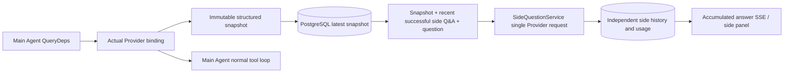

# LEVIATHAN `/btw`

Normal chat, the task MainAgent, and the current task's own Worker all support independent side questions. Type `/btw question` in the main input box to submit; an empty `/btw` or the "Side question" button opens the history. Desktop uses a resizable sidebar; mobile uses a Drawer.

Side answers are generated from the Agent context snapshot captured at submission time, and support streaming display, follow-ups, stop, and clear. Closing the panel, refreshing the page, or disconnecting SSE does not cancel the model request. Stop only affects the current side question; clear cancels the side question and deletes side history while retaining the main context snapshot.

## Implementation Boundaries

Reuses Go, norma v0.3.7, Next.js, and the existing Markdown / ResizablePanel / Drawer / AlertDialog components; no norma source changes and no new dependencies for side questions. Planner, Workers inherited from other tasks, and tool-type subtask upgrades are out of scope.

- `capture.go` only marks main-loop requests at `Options.Deps.CallModel / CallModelSync`. The Provider decorator sits inside the concrete model, after the routing pool's outer selection, so it records the actually selected model; compaction and summary requests do not overwrite the snapshot.
- A snapshot is published at request start, on a complete model reply, and at run terminal state. A half-generated reply in progress is not published; tool calls stay paired through norma's `MessagesForAPI`, and tool results enter the snapshot on the next main model request or at run terminal state. A streaming abort retains the last valid boundary.
- Snapshots retain structured messages, system prompt, tool definitions, and generation params via JSON deep copy. Model inference holds no snapshot lock or database transaction.
- `SideQuestionService` calls the concrete Provider; when needed it first generates a side summary, and the final answer allows only one reduced retry, only when the context first exceeds the limit and no text/tool call has been output yet. It creates no agent session, does not hook into the tool executor, main transcript, activity stream, or task graph, and does not go through the task model-switching chain. The answer retains tool definitions for compatibility with existing structured tool context; the summary request provides no tools. Newly returned tool calls have no execution path.
- One running request per parent session, at most four per service process, with a single 120-second timeout. Side questions use an independent cancellation context under the service lifetime.
- Side requests retain the model config reference and a non-sensitive identity digest; credentials are fetched from the existing config at request time. If the config is deleted, or identity fields such as model, protocol, or address change, the main Agent must be run first to update the snapshot. Tests do not change the product's default model.

## Persistence and Recovery

`db/schema.sql` automatically creates `side_question_sessions` and `side_question_requests`. The former stores the parent resource, latest snapshot, run number, version, and clear version; the latter stores the question, accumulated answer, status, model, snapshot time, usage, event sequence, and page sequence.

The parent-session key uses the conversation ID, or task ID + exploration ID + intent ID. Workers do not use reusable execution-slot naming.

Snapshots are merged and written per parent session, refreshed every 250 ms, and the database compares `(run_id, version)` to prevent an older version from overwriting. The selected snapshot is saved again before a side submission. After a successful save the large in-memory snapshot is released; on failure the pending version is retained. Accumulated answer content is written at most once every 250 ms as streaming events arrive, and terminal state is saved immediately with bounded retries on database errors.

On service start, leftover `running` requests are marked `interrupted`, retaining the partial answer and usage already persisted, without automatically replaying the request. The most recently successfully saved context can be used directly for the next question. When an old session has no snapshot, the main Agent must be run first; the context is not rebuilt from UI activity records.

Clearing increments the clear version and deletes the request; a conditional update prevents a late callback from writing back. Physical parent deletion relies on foreign-key cascade; a Worker logical delete removes side data in the same transaction and rejects subsequent late snapshots. Task archiving first blocks new requests, waits for the main flow to stop, then cancels and waits for side data to persist; the archive format is v3 and remains compatible with v1/v2, which have no side-question tables.

History is fully preserved and returns at most 20 entries per page by sequence cursor. Model requests replay at most the most recent 20 successful Q&A originals, also bounded by token budget; older Q&A maintains an independent rolling summary. When the main context is over budget, only the old part of the side copy is summarized, retaining recent structured tool calls and results. Summary, preparation progress, and usage are all subject to the side question's concurrency, cancellation, and 120-second timeout limits. See [Context Budget and Open-Source References](CONTEXT_BUDGET.md).

## HTTP Contract

The following paths serve as `{parent}`, reusing the existing authentication and resource checks:

- `/api/conversations/{id}`
- `/api/tasks/{id}/chat`
- `/api/tasks/{id}/intents/{iid}`

| Request | Response and behavior |
| --- | --- |
| `GET {parent}/side-questions?before={ordinal}` | `items` ordered newest to oldest, an independent `current` run state, `snapshot` metadata, `next_cursor`; a cursor of 0 means the newest page / no next page |
| `POST {parent}/side-questions` | JSON `{ "question": "…", "client_request_id": "UUID" }`; a new request returns 202 and the request object; the same ID and question returns the existing object 200 |
| `DELETE {parent}/side-questions` | Cancel and clear the current parent session's side questions |
| `GET /api/side-questions/{requestID}/events` | `snapshot` SSE events, `id` is an increasing sequence, `data` is the full accumulated request object; sends `cleared` on clear |
| `POST /api/side-questions/{requestID}/cancel` | Explicit cancel; terminal state is available from history or SSE |

Question limit is 4000 characters. No snapshot, changed model config, busy same parent session, or idempotency ID conflict returns 409; global concurrency limit returns 429. Every SSE connection first sends the accumulated state and does not depend on text fragments the client received before. The frontend merges by request ID + sequence and discards old callbacks when switching parent sessions or clearing.

## Validation and References

See [VALIDATION.md](VALIDATION.md) for automated checks, actual model usage, and known limitations.

Independent-request reference [Grok CLI side-question.ts (fixed commit)](https://github.com/superagent-ai/grok-cli/blob/fb97af83f06dca873281d60168430f06c8de6324/src/utils/side-question.ts); run-isolation reference [OpenCode (fixed commit)](https://github.com/anomalyco/opencode/tree/b3f1a96c6dd7adeb28b36dd11add1998fc84d67b). LEVIATHAN's context uses norma's structured messages rather than concatenating text from frontend logs.
